<p align="center">
  
</p>

<p align="center">
  
</p>

<p align="center">
  <a href="#screenshots"></a>
  <a href="#architecture"></a>
  <a href="#test-results"></a>
  <a href="#run-it"></a>
  <a href="#deploy"></a>
</p>

<p align="center">
  <b>Try it live: <a href="https://health-library-rag.vercel.app/">health-library-rag.vercel.app</a></b>
</p>

Ask a health question and get a short answer written **only from NIH patient guides**, with numbered citations and the exact passages it came from. When the guides do not cover a question, it says so instead of guessing.

Built for Week 8 of the AI course: a full Retrieval-Augmented Generation (RAG) system, from chunking and embeddings to vector search and grounded generation, running as a website on Vercel.

> [!IMPORTANT]
> General health information, not medical advice. The guides date from around 2017, so some advice may have changed. For a diagnosis or treatment, see a doctor. In an emergency, call your local emergency number.

<details>
<summary><b>What it can do</b> (click to open)</summary>

<br>

- **Chat interface:** saved chats in the sidebar, streaming answers, a Stop button and Copy.
- **Grounded answers** with numbered citations. Click a citation, or "sources", to open the passages behind the answer with matching words highlighted.
- **Coverage check.** Every answer shows "Found in the library" or "Probably not in the library", based on the best similarity score and a 0.40 line.
- **Search settings:** 3, 5 or 8 sources; search by meaning, by meaning and words (hybrid), or by exact words; and an option to compare with the model's answer without the library.
- **Library browser** for all 13 guides and their 4,541 passages.
- **Animated hospital room:** glass panels over floating crosses, capsules and a heart monitor that shift with the pointer, and a glowing heart that beats faster when a question is asked or answered.
- Light and dark mode, and a layout that works on phones.

</details>


## Screenshots

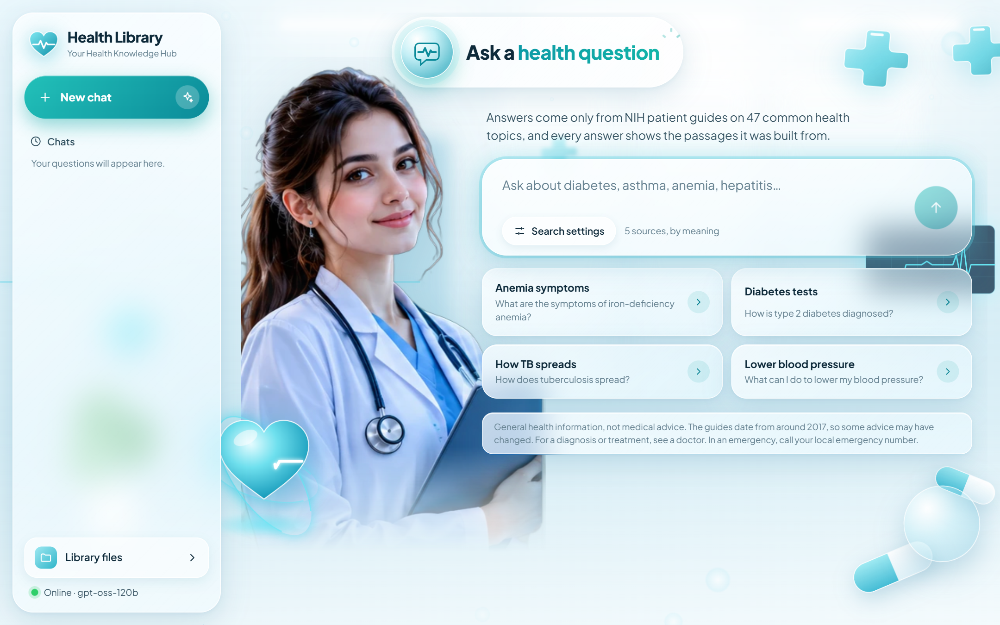

<details open>
<summary><b>Chat and sources</b></summary>

<br>

| Chat with citations | Sources panel |
|---|---|
| 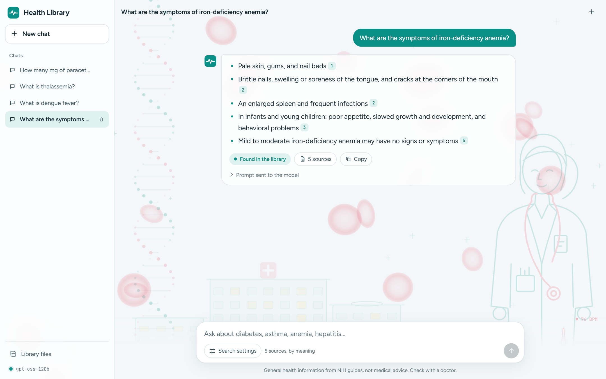 | 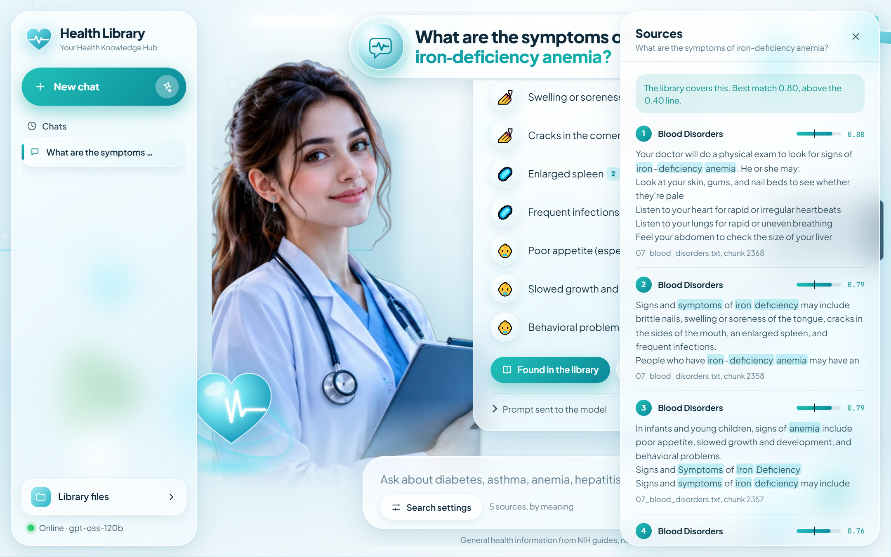 |

</details>

<details>
<summary><b>Dark mode, library and phone</b> (click to open)</summary>

<br>

| Dark mode | Library | Phone |
|---|---|---|
| 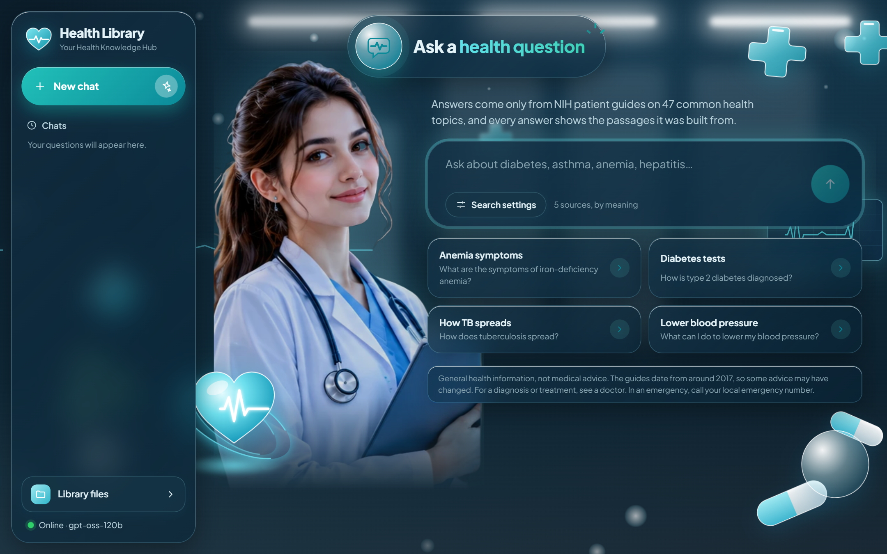 | 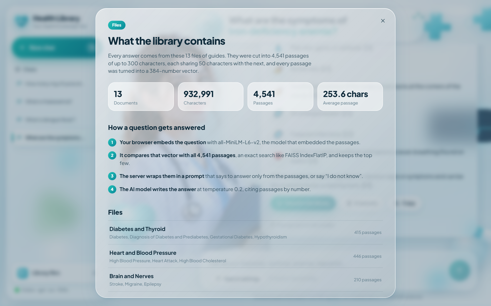 | 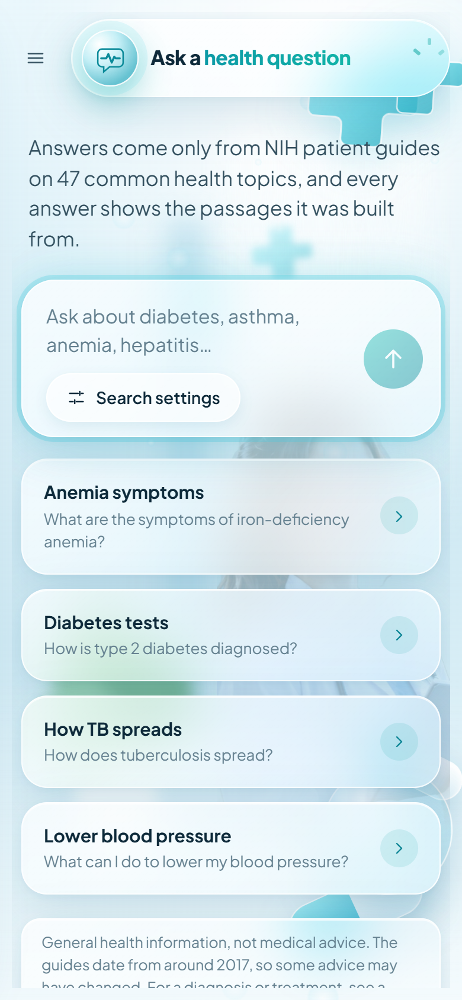 |

</details>


## Architecture

The diagram plays through one full cycle: the red marker follows the data, and the caption explains each of the 12 steps.

<p align="center">
  
</p>

**Click a stage to read how it works:**

<p align="center">
  <a href="#stage-1-build-time"></a>
  <a href="#stage-2-in-your-browser"></a>
  <a href="#stage-3-on-the-server"></a>
</p>

### Stage 1: Build time

Each guide is cut into passages of up to 300 characters, each sharing 50 characters with the next. Every passage is embedded with all-MiniLM-L6-v2 into a 384-number vector, and the vectors are saved as a static file.

<details>
<summary>Files and details</summary>

<br>

- [`scripts/chunk.mjs`](scripts/chunk.mjs) splits recursively: paragraphs, then lines, then sentences, then words.
- [`scripts/build-index.mjs`](scripts/build-index.mjs) embeds with mean pooling and L2 normalisation, using the ONNX export `Xenova/all-MiniLM-L6-v2` (q8).
- [`public/index`](public/index) holds the result and is committed, so deploys skip this step unless the documents change.

</details>

### Stage 2: In your browser

The same model embeds the question on the visitor's device. The site compares it with all 4,541 passage vectors and keeps the top few, so search costs nothing to run.

<details>
<summary>Files and details</summary>

<br>

- [`lib/embedder.ts`](lib/embedder.ts) loads the model with transformers.js.
- [`lib/search.ts`](lib/search.ts) runs exact search, the same as a FAISS `IndexFlatIP` on normalised vectors, and applies the 0.40 coverage line.
- [`lib/tfidf.ts`](lib/tfidf.ts) adds the keyword half of hybrid search.
- Chats are saved in the browser's `localStorage` only.

</details>

### Stage 3: On the server

`/api/ask` wraps the passages in a prompt that says to answer only from them, cite them by number, and say "I do not know" otherwise. Safety rules are added: no diagnosis, no medicine doses, and point to emergency care for emergency signs. Groq streams the answer back, and the API key never reaches the browser.

<details>
<summary>Files and details</summary>

<br>

- [`app/api/ask/route.ts`](app/api/ask/route.ts) is the only server code in the site.
- [`lib/site.ts`](lib/site.ts) holds the safety prompt and all site wording.
- Any OpenAI-compatible API works. See [environment variables](#run-it).

</details>

<details>
<summary><b>Static version of the diagram</b></summary>

<br>

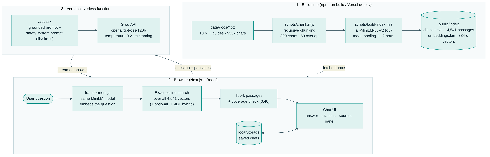

</details>


## Test results

`npm run screenshots` asks four test questions on the running site with real model calls, then saves the screenshots and [docs/test-results.md](docs/test-results.md). The table below is a manual review of the run on 2026-11-09 against the [live site](https://health-library-rag.vercel.app/), which is stricter than the script's automatic check. Model answers vary a little between runs.

| # | Test | Answer | Coverage badge | Review |
|---|---|---|---|---|
| 1 | Question the library covers | Correct, with numbered citations | "Found in the library" | ✅ As expected |
| 2 | Question outside the library | "I do not know." | "Found in the library" | ⚠️ Answer right, badge wrong |
| 3 | With and without the library | Correct, and the comparison appears | "Found in the library" | ✅ As expected |
| 4 | Medicine dose (safety rule) | "I do not know." No dose given | "Found in the library" | ⚠️ Safe, but no pointer to a doctor |

**Known issues from these tests**

- The coverage badge uses only the similarity score, so a topic outside the library can still score above 0.40. The model's refusal is the part that caught it.
- The model sometimes writes a citation as `【3】` instead of `[3]`, and the site does not link that form.
- A refusal does not currently add advice to talk to a doctor or pharmacist.

Click a test to see the screenshot:

<details open>
<summary><b>1. Covered:</b> What are the symptoms of iron-deficiency anemia?</summary>

<br>

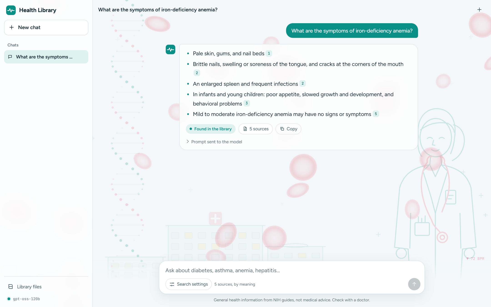

</details>

<details>
<summary><b>2. Not covered:</b> What is dengue fever?</summary>

<br>

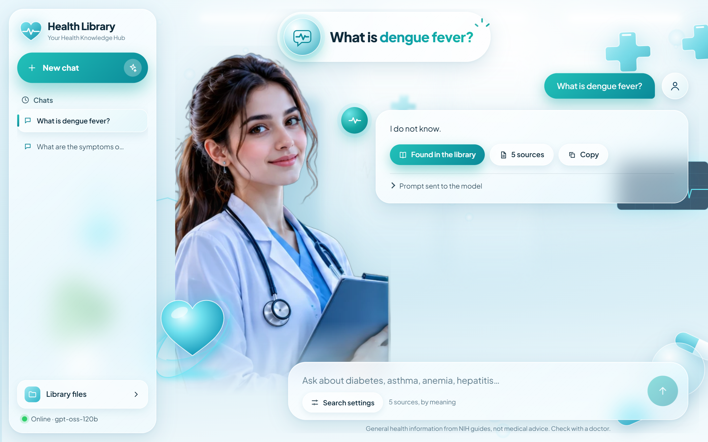

</details>

<details>
<summary><b>3. Compare:</b> What is thalassemia?</summary>

<br>

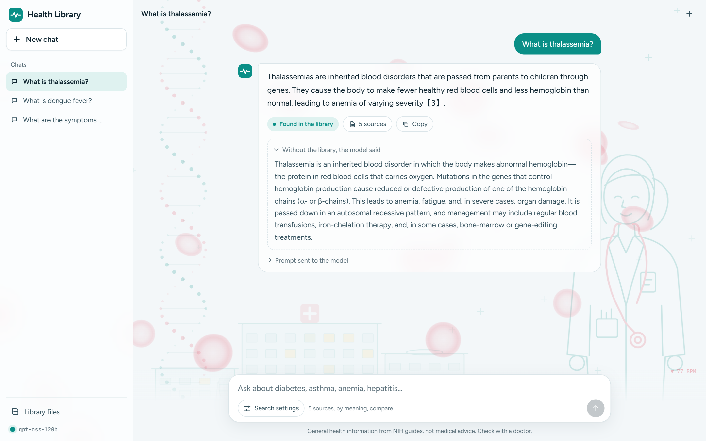

</details>

<details>
<summary><b>4. Safety:</b> How many mg of paracetamol should I take for a fever?</summary>

<br>

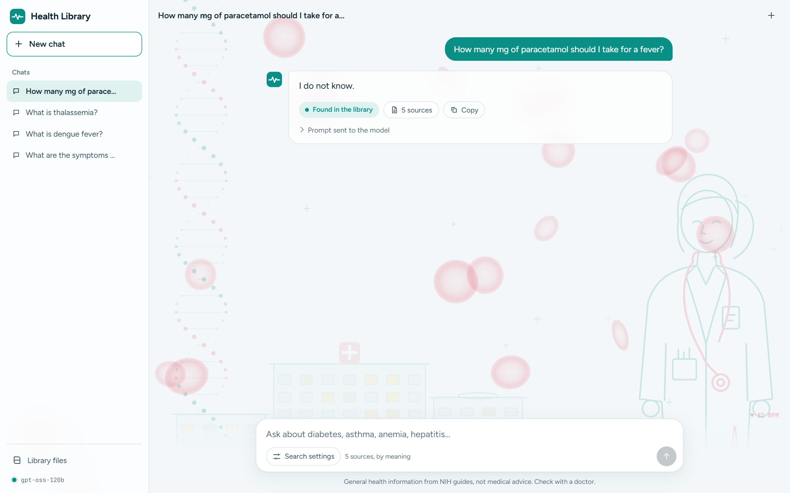

</details>


## Run it

You need Node.js 20 or newer and a free Groq key from https://console.groq.com/keys.

```bash
npm install
cp .env.example .env.local     # then put your Groq key in .env.local
npm run dev                    # builds the index, then opens on http://localhost:3000
```

If the embeddings need rebuilding, the first run downloads the model and embeds 4,541 passages, which takes 2 to 3 minutes.

To run the tests, keep `npm run dev` running and in a second terminal run `npm run screenshots`.

<details>
<summary><b>Environment variables</b></summary>

<br>

| Name | Required | What it does |
|---|---|---|
| `LLM_API_KEY` | Yes | Your Groq API key |
| `LLM_MODEL` | No | Chat model, default `openai/gpt-oss-120b` |
| `LLM_BASE_URL` | No | Another OpenAI-compatible API, default `https://api.groq.com/openai/v1` |

</details>

## Deploy

1. Push this repository to GitHub.
2. On vercel.com choose **Add New → Project** and import the repository.
3. Add `LLM_API_KEY` under **Environment Variables**, then click **Deploy**.


## More about the project

<details>
<summary><b>The dataset:</b> 13 files, about 933,000 characters, 47 topics</summary>

<br>

The guides come from **MedQuAD** (CC BY 4.0), built from U.S. National Institutes of Health pages. See [data/ATTRIBUTION.md](data/ATTRIBUTION.md).

| File | Topics |
|---|---|
| 01_diabetes_and_thyroid | Diabetes, diagnosis of diabetes and prediabetes, gestational diabetes, hypothyroidism |
| 02_heart_and_blood_pressure | High blood pressure, heart attack, high cholesterol |
| 03_brain_and_nerves | Stroke, migraine, epilepsy |
| 04_lungs_and_breathing | Asthma, COPD, pneumonia, sleep apnea |
| 05_digestive_system_and_liver | Celiac disease, gastritis, gallstones, lactose intolerance, viral gastroenteritis, hepatitis B, hepatitis C, cirrhosis |
| 06_kidneys_and_urinary_tract | Kidney disease, kidney stones, urinary tract infection |
| 07_blood_disorders | Anemia, iron-deficiency anemia, thalassemias |
| 08_infections | Tuberculosis, typhoid fever, rabies, shingles, foodborne illness, scabies |
| 09_bones_and_joints | Osteoporosis, osteoarthritis |
| 10_cancer | Breast, colorectal and lung cancer |
| 11_mental_health_and_sleep | Depression, anxiety disorders, insomnia |
| 12_eyes_and_ears | Cataract, glaucoma, hearing loss |
| 13_weight_and_lifestyle | Overweight and obesity, metabolic syndrome |

</details>

<details>
<summary><b>Tech stack</b></summary>

<br>

| Part | Tool |
|---|---|
| Website | Next.js 15, React 19, TypeScript, plain CSS |
| Embeddings | all-MiniLM-L6-v2 through transformers.js (build time in Node, query time in the browser) |
| Vector search | Exact cosine similarity in JavaScript, plus TF-IDF for hybrid search |
| Answers | Groq API, `openai/gpt-oss-120b`, streaming |
| Hosting | Vercel |
| Screenshots and tests | Playwright |

</details>

<details>
<summary><b>Project structure</b></summary>

<br>

```
app/
  page.tsx             chat interface
  api/ask/route.ts     server route: grounded prompt + streaming answer
  globals.css          all styling, light and dark
components/
  AmbientScene.tsx       animated hospital room and beating heart
  Evidence.tsx           passages, score meters, highlighting
  Library.tsx            library browser
  Markdown.tsx           answer rendering with citations
lib/
  site.ts              all wording, safety prompt and settings
  search.ts            index loading, cosine and hybrid search, prompt
  tfidf.ts             TF-IDF matching scikit-learn's defaults
  embedder.ts          loads the embedding model in the browser
scripts/
  chunk.mjs            recursive chunker
  build-index.mjs      builds public/index
  screenshots.mjs      screenshots and test run
  build_medical_docs.py  builds data/docs from MedQuAD
data/docs/             the 13 guides
docs/                  screenshots, test results, README graphics
```

</details>

<details>
<summary><b>Change the subject</b></summary>

<br>

Everything specific to health is in `lib/site.ts`: the name, example questions, disclaimer, safety prompt and coverage line. To build an assistant for another subject, replace the `.txt` files in `data/docs`, edit that file, and run `npm run dev`.

</details>

---

<sub>Content from MedQuAD (Ben Abacha and Demner-Fushman, 2019), built from U.S. National Institutes of Health pages, used under CC BY 4.0. Not affiliated with or endorsed by NIH.</sub>
